# Atlas Portal: Admin Dashboard & Client File Portal

An internal tool for an agency or service business: admins manage clients, users and projects, and each client gets a private file portal to exchange documents.

**Live demo:** https://ozenyunus35.github.io/admin-file-portal/

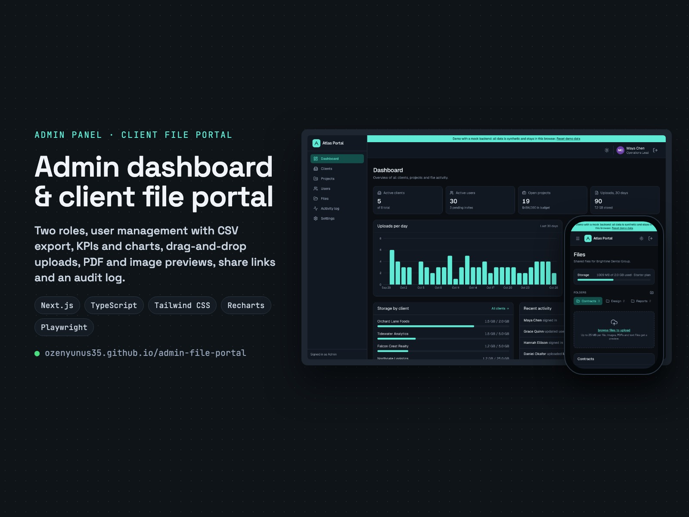

> **This is a demo with a mock backend.** There is no server: all data is synthetic and lives in your browser
> (localStorage for records, IndexedDB for uploaded files). Companies, people and files are invented, and emails
> use the reserved `.example` domain. Use **Reset demo data** to start over.

## Try it

Open the live demo and pick a role. No sign-up and no password.

| Role | Can do |
| --- | --- |
| **Admin** (Maya Chen) | Everything: dashboard for all clients, users, clients, projects, every client's files, activity log |
| **Client** (Jordan Park, Brightline Dental Group) | Own company only: project progress, the company's file portal, share links |

You can also sign in with any seeded email, for example `daniel@atlasportal.example`.

## Features

**Admin**
- Dashboard: metric strip with sparklines and week-over-week change, daily uploads and sign-ins with a
  7/14/30-day switch, projects by status, projects due soon (overdue flagged), storage per client, recent activity.
- Users table with search, filters (role, status, company), sortable columns, pagination, invite, edit, disable/enable, and CSV export of the filtered rows.
- Clients with plan and storage quota; changing the plan changes the quota.
- Projects as a board (one column per status, progress, owner, due date) or a sortable table, with
  status, progress and owner editing and CSV export.
- Activity log (audit trail) of sign-ins, edits, uploads, downloads, shares and exports, with CSV export.

**File portal**
- Folders per client, new folders, search inside a folder.
- Drag-and-drop or browse upload with per-file progress, duplicate names renamed to `name (1).ext` (then `(2)`,
  and `.tar.gz` kept together). Names are cleaned: no paths, control or text-direction characters, 180 characters at most.
- Limits enforced before upload: 25 MB per file, no empty files, and the client's storage quota (with a warning at 85%).
- Preview for images, PDFs (rendered with PDF.js, so it also works on Android and iOS), CSV and text. The preview
  goes by the file's content, not its name: a PNG renamed `.pdf` shows as an image with a note, binary data renamed
  `.txt` isn't dumped as text, CSV with `;` or tab separators and multi-line cells reads correctly, and UTF-16 or
  Windows-1252 text is decoded. HEIC and TIFF photos get a clear message.
- Uploaded SVG and HTML files can't run script: they preview as an image or as source, and "Open in new tab" is
  only offered for PDFs, raster images and plain text.
- Download, delete (clients can only delete their own uploads), and share links with 1, 7 or 30 day expiry,
  download counter and revoke. A link stops working when its creator is disabled or the client is paused; clients
  can revoke only their own links, and revokes and link downloads go into the activity log.

**Everywhere**
- Command palette (⌘K / Ctrl+K): search pages, clients, projects, people and files, keyboard navigation, switch theme or language.
- English and Turkish interface on every screen, including the sign-in page, the shared-file page, statuses, table headers, error messages and toasts. Dates, sizes and amounts follow the language.
- Notifications panel and short transitions that respect `prefers-reduced-motion`.
- Restrained product UI: neutral greys with one accent colour, Inter, compact 13px base size, status glyphs.
- Role-based access: clients never see admin pages or other companies' data; the mock API enforces it too, and
  checks the acting user against current data, so a session opened before a disable, demotion or pause loses access at once.
- Server-side validation in the mock API: quotas can't drop below what a client already stores, project progress is a
  whole number from 0 to 100, completed projects are at 100%, owners are active team members, due dates follow start dates.
- Responsive layout with a mobile menu, designed dark and light themes, keyboard-friendly dialogs and tables
  (`aria-sort`, labelled controls, focus rings), empty, loading and error states.

| Sign-in | Dashboard |
| --- | --- |
| 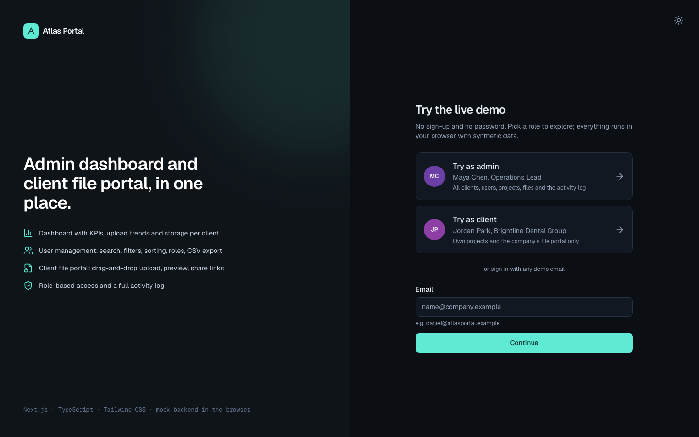 | 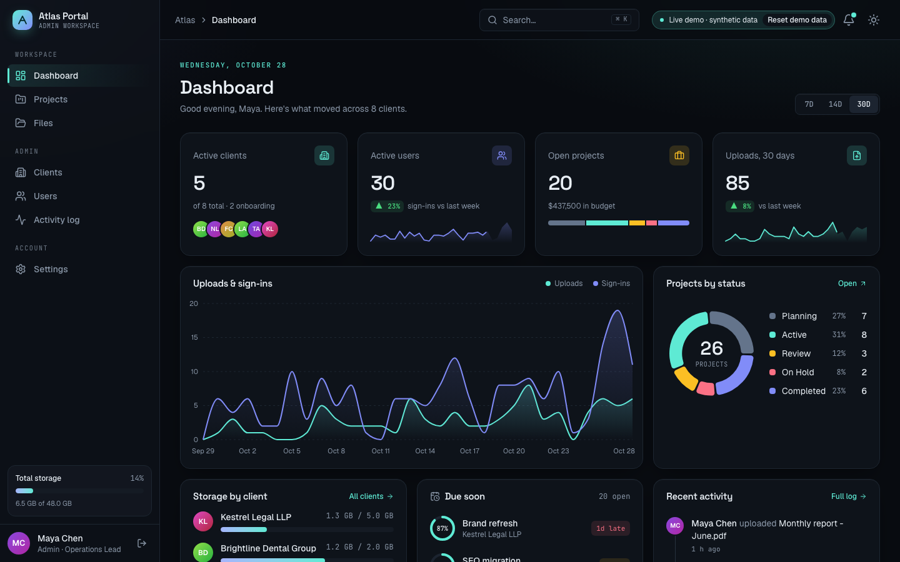 |
| **Projects board** | **Command palette** |
| 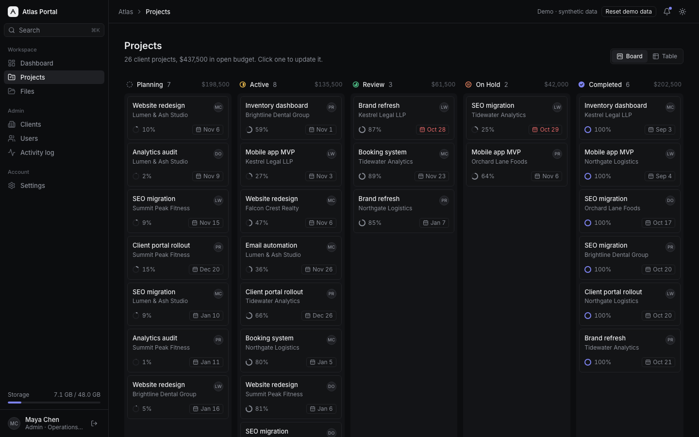 | 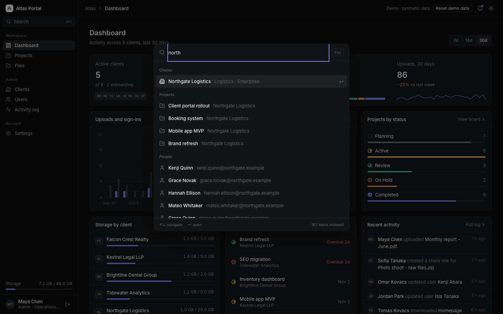 |
| **Users** | **Light theme** |
| 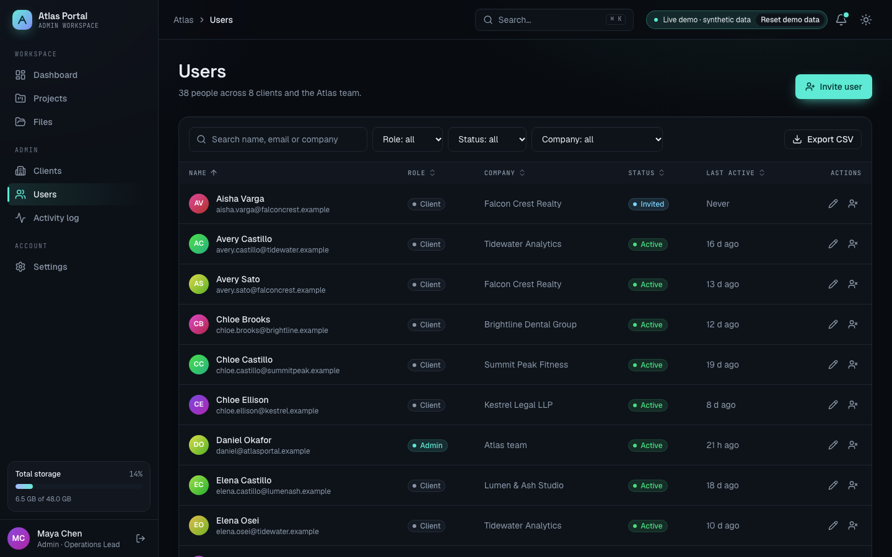 | 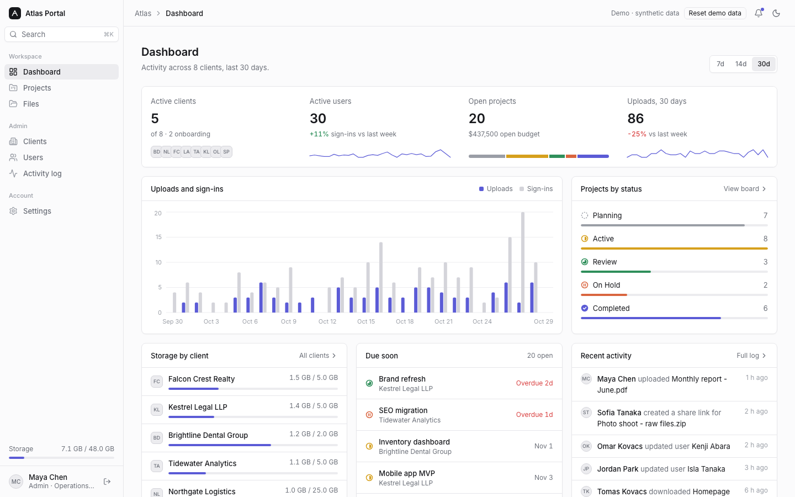 |
| **File portal** | **PDF preview** |
| 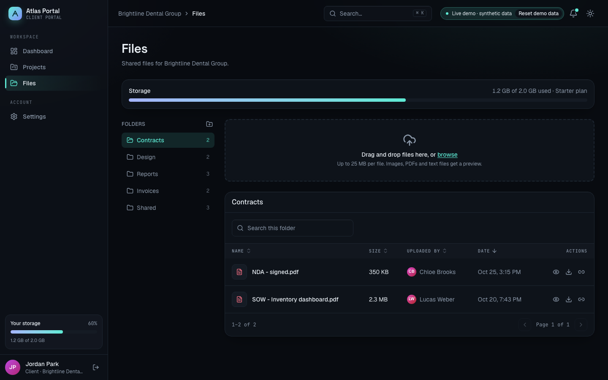 | 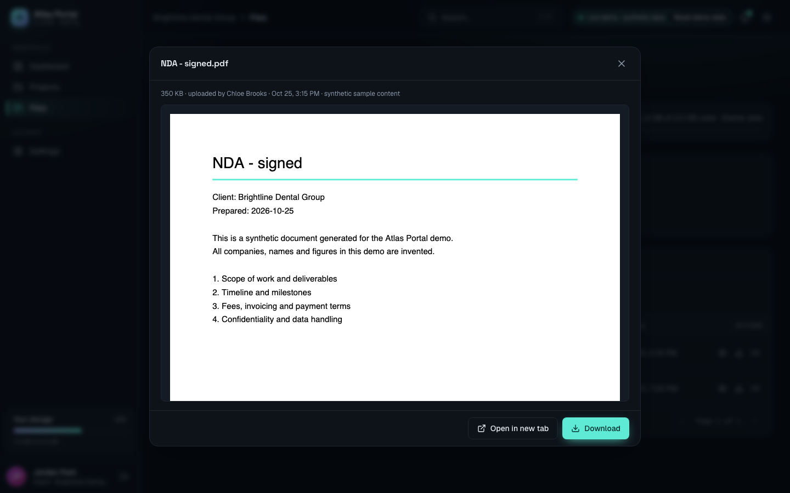 |

<p align="center">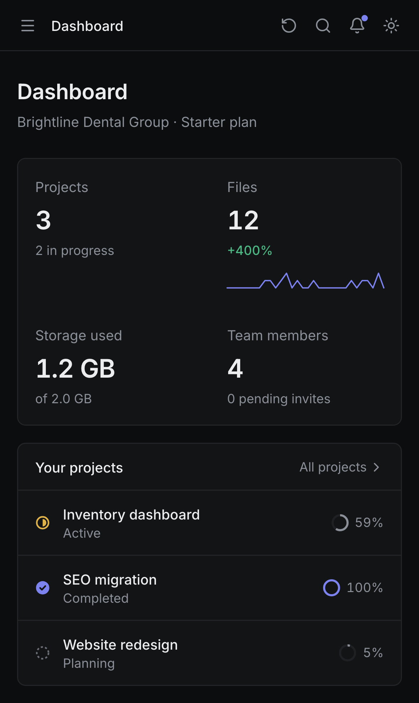 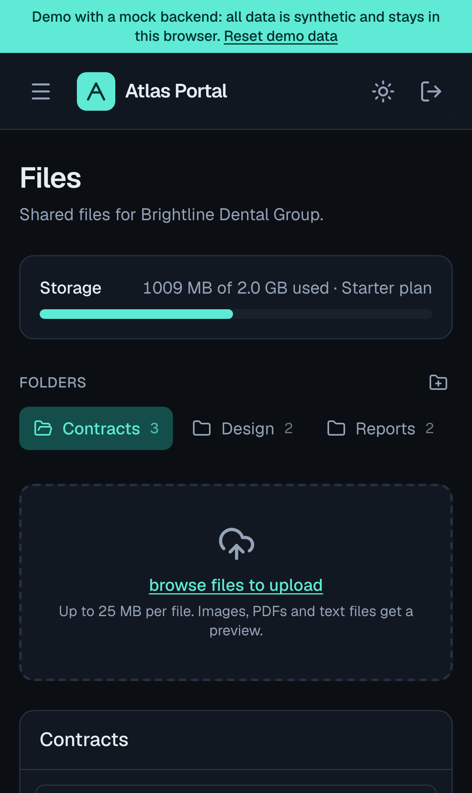</p>

## How the mock backend maps to a real one

All reads and writes go through [`src/lib/api.ts`](src/lib/api.ts). Each function takes the current state and the
acting user, checks permissions the way a server would, and returns the new state or throws an `ApiError` with an
HTTP-like status (400, 403, 404, 409, 413). Swapping in a real backend means replacing those functions with
`fetch` calls; the pages don't change.

| Demo | Production |
| --- | --- |
| `createUser`, `updateUser`, `setUserStatus` | `POST /api/users`, `PATCH /api/users/:id` (Next.js route handlers or Supabase) |
| `checkUpload` + IndexedDB `putBlob` | Signed upload URL to S3 / Supabase Storage, quota checked on the server |
| `createShare`, `resolveShare` | Share table with random token and expiry; download through a signed URL |
| `log` (activity) | Append-only audit table, written by the API, never by the client |
| Demo role buttons | Real auth (NextAuth/Auth.js, Supabase Auth or Clerk) with the same `admin` / `client` roles |

Share links in the demo only open in the browser that created them, because the data never leaves it.

## Run it locally

```bash
npm install
npm run dev          # http://localhost:3000
npm test             # unit tests (Vitest)
npm run build        # static export in out/
```

End-to-end tests run against the static build, served under `/admin-file-portal/` like on GitHub Pages:

```bash
npx playwright install chromium webkit
PAGES_BASE_PATH=/admin-file-portal npm run build
npm run test:e2e     # desktop Chrome, desktop Safari (WebKit), iPhone, Android
BASE_URL=https://ozenyunus35.github.io/admin-file-portal/ npm run test:e2e   # against the live site
```

## Tests

- **Unit (Vitest):** seed data integrity, every mock API rule (permissions, validation, quota, share expiry),
  table search/sort/pagination, CSV escaping and formula-injection guard, generated PDF and ZIP structure, KPIs,
  file-type detection from content, text decoding and CSV parsing.
- **Fuzz (Vitest):** random sessions of API calls by random users (including disabled ones, paused clients and stale
  sessions) with broken input, checking after every successful call that the rules a server must keep still hold;
  and 1,500 random files (binary, UTF-8, UTF-16, Windows-1252, CSV with random separators and quoting). On 200 seeds
  the API before this check broke a rule in every session; now there are none.
- **End-to-end (Playwright):** sign-in, user management, CSV download, project edits, client access limits,
  uploads with progress, previews (including script-carrying SVG/HTML, renamed and binary files, `;` CSV), share
  links and who may revoke them, paused clients, delete, error states, theme, reset, and a check that no page
  scrolls sideways, on four browser/device profiles.

GitHub Actions runs lint, type check, unit and e2e tests on every push to `main`, then deploys to GitHub Pages.

## Tech

Next.js 16 (App Router, static export), React 19, TypeScript, Tailwind CSS 4, Recharts, PDF.js, Lucide icons,
Vitest, Playwright. MIT License.
